<!-- terminal.svg é gerado por scripts/terminal.py -->

<h3><code>jefferson@github ~ $ ./hello.sh</code></h3>

 
 

<h3><code>jefferson@github ~ $ ls ~/projetos</code></h3>

<table>
<tr>
<td width="33%" valign="top">

**🏝️ [orbit2.0](https://github.com/jeffersonmds/orbit2.0)**

Dynamic Island para o Windows: controles, stats, clipboard e uma ponte segura com o iPhone.

WPF · .NET 10 · PWA · Web Push

</td>
<td width="33%" valign="top">

**🃏 [mesa-comum](https://github.com/jeffersonmds/mesa-comum)**

Jogo de mesa multiplayer no navegador: monte combinações e roube as dos amigos.

ASP.NET Core · SignalR

</td>
<td width="33%" valign="top">

**♟️ [chess-console](https://github.com/jeffersonmds/chess-console)**

Xadrez no console com as regras completas: roque, en passant e promoção.

C# · .NET

</td>
</tr>
</table>

 

<h3><code>jefferson@github ~ $ ./contato.sh</code></h3>

 

🇺🇸 <b>English</b>

 

Hi, I'm **Jefferson**, a C#/.NET developer from Brazil. I like building things I use every day:
Windows desktop apps, web systems and games that run in the browser.

**Stack:** C# · .NET · WPF · ASP.NET Core · SignalR · TypeScript · Angular · SQL

- 🏝️ **[orbit2.0](https://github.com/jeffersonmds/orbit2.0)**: a Dynamic Island for Windows (WPF, .NET 10) with quick controls, system stats, clipboard history and a secure bridge to the iPhone.
- 🃏 **[mesa-comum](https://github.com/jeffersonmds/mesa-comum)**: multiplayer tabletop game in the browser: build combinations and steal your friends'. ASP.NET Core + SignalR.
- ♟️ **[chess-console](https://github.com/jeffersonmds/chess-console)**: console chess in C# with the full rules: castling, en passant and promotion.

📫 [LinkedIn](https://www.linkedin.com/in/jeffersonmds) · [jeffmorais96@gmail.com](mailto:jeffmorais96@gmail.com)

